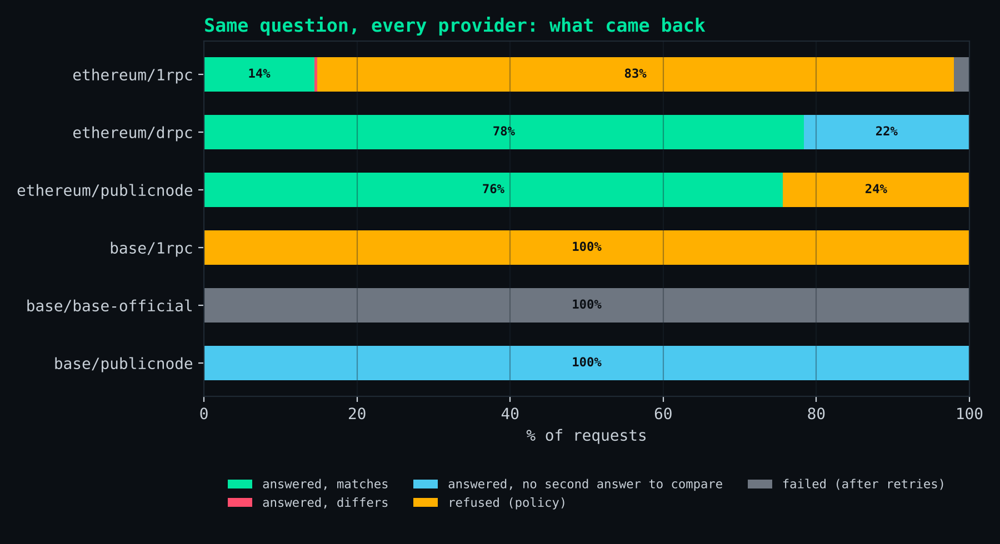
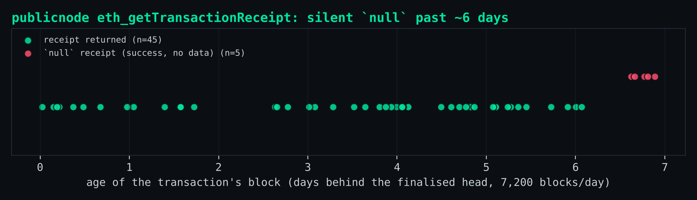
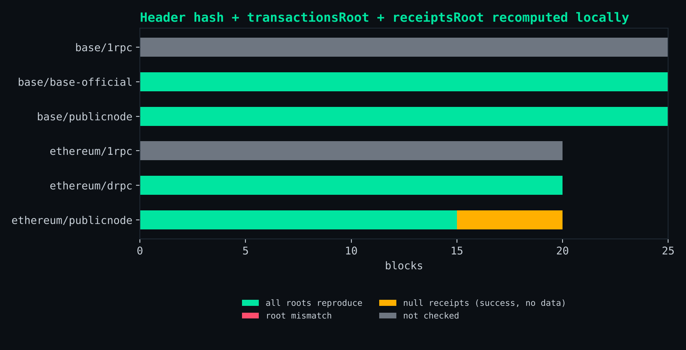
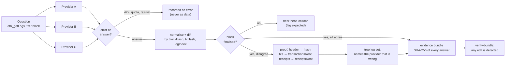
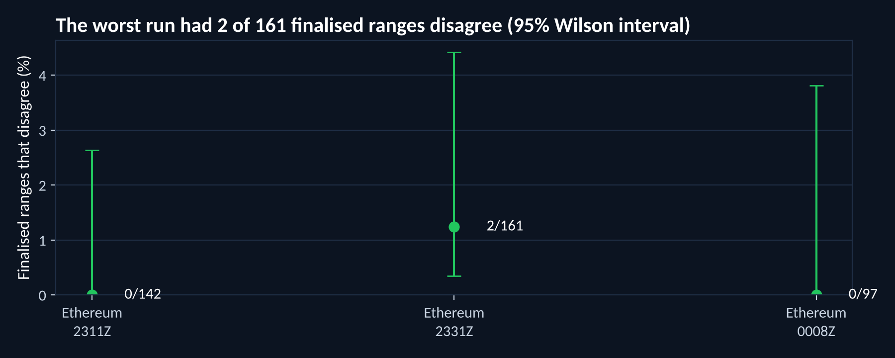
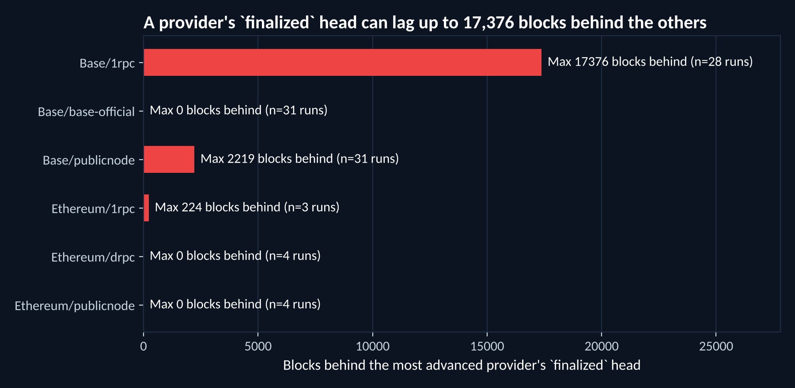

# chain-evidence

[](https://github.com/itsashutoshpsingh/chain-evidence/actions/workflows/ci.yml)


**Across 524 finalised Ethereum block ranges asked of three free RPC providers, every recent range agreed (383/383), but on older blocks a provider silently returned nothing where receipt proofs show 286 logs (2/20 comparable ranges), and publicnode returned `null` receipts for 7/7 sampled transactions older than ~6 days.**

| Chain | Ranges checked | Comparable (≥2 answers) | Disagreements | Missing logs | Not finalised (checked separately) |
|---|---|---|---|---|---|
| ethereum (recent) | 383 | 383 | 0 (0.0%, 95% CI 0.0–1.0%) | 0 | 80 (0 disagreed) |
| ethereum (deep history) | 141 | 20 | 2 (10.0%, 95% CI 2.8–30.1%) | 286 | — |



On-chain evidence is read through RPC providers, not from the chain. `chain-evidence` asks several
independent providers the same question, records every answer in a hashed evidence bundle, and
settles any disagreement with proof: it recomputes the block's `receiptsRoot`, `transactionsRoot` and
block hash locally, so the true set of logs is known without trusting any provider.

## What I found

1. **Silent empty answers on older blocks.** In the deep-history stratum (9,000–50,000 blocks back),
   1rpc answered 2 finalised queries with `[]` and no error. Each time, the adjudicator rebuilt
   the true log set from receipts that reproduce `receiptsRoot` and found the logs were there:
   286 missing logs in total. No recent range showed this
   (383 comparable, 0 disagreements).
2. **`null` receipts past ~6 days.** publicnode returns `result: null` for `eth_getTransactionReceipt` and
   `eth_getBlockReceipts` on blocks older than about 43,700–45,000 blocks, while `eth_getTransactionByHash`
   still returns the transaction. A reader would conclude the transaction has no receipt. It happened in
   7 of 70 sampled Ethereum transactions: every sampled transaction at least 47,687 blocks deep and none at 43,674 or less.
3. **Most failures are refusals, not lies.** publicnode refuses `eth_getLogs` beyond ~5,000–10,000 blocks,
   drpc's free tier refuses ranges over a few hundred blocks (while its message says 10,000), and
   mainnet.base.org refuses `eth_getLogs` outright. All of these are honest errors and are counted as
   errors, never as disagreements (see the chart above).
4. **Proofs held everywhere they could be run.** 101 of 101 provider-block pairs on
   Ethereum and Base reproduced the header hash, `transactionsRoot` and `receiptsRoot`, including blob
   (type 3), EIP-7702 (type 4) and OP Stack deposit (`0x7e`) transactions. No provider served altered
   receipts; the failures were missing data, not wrong data.
5. **Transactions agree when they are answered.** 62/70
   Ethereum and 30/30 Base transactions had identical
   transaction and receipt objects across answering providers. The Ethereum exceptions were all `null` receipts: 1 from 1rpc, 7 from publicnode; the 1rpc one was for a transaction only ~2.9 days old that both other providers returned.
6. **"Finalized" means different things to different providers.** Across 31 snapshots of Base heads
   (mostly every two minutes for an hour), the `finalized` head sat a median 5,033 blocks
   (~2.8 h) behind `latest`. publicnode's `finalized` was behind base.org's in 12/30
   samples (by up to 2,219 blocks), and 1rpc's was stale in 28/28 (by up to 17,376 blocks,
   ~9.7 h). This tool takes the lowest `finalized` head across providers, so staleness makes it
   more cautious, never less.

<p align="center"></p>

### Proof, not majority vote

Two providers agreeing does not make an answer complete. Every block below was rebuilt from the
provider's own data and checked against the header the whole network agrees on.

| Provider | Blocks checked | Header hash | transactionsRoot | receiptsRoot | eth_getLogs vs proven receipts | `null` receipts (success, no data) | Not checked (refused / quota) |
|---|---|---|---|---|---|---|---|
| base/1rpc | 0 | 0/0 | 0/0 | 0/0 | n/a | 0 | 25 |
| base/base-official | 25 | 25/25 | 25/25 | 25/25 | n/a | 0 | 0 |
| base/publicnode | 25 | 25/25 | 25/25 | 25/25 | 25/25 match | 0 | 0 |
| ethereum/1rpc | 0 | 0/0 | 0/0 | 0/0 | n/a | 0 | 28 |
| ethereum/drpc | 28 | 28/28 | 28/28 | 28/28 | 28/28 match | 0 | 0 |
| ethereum/publicnode | 23 | 23/23 | 23/23 | 23/23 | 5/5 match | 5 | 0 |

<p align="center"></p>

## How it works





## Use it

```bash
git clone https://github.com/itsashutoshpsingh/chain-evidence && cd chain-evidence
python -m venv .venv && . .venv/bin/activate
pip install -r requirements.txt && pip install -e .
pytest -q                                   # offline, recorded mainnet and Base blocks

chain-evidence heads                                         # latest / finalized per provider
chain-evidence check --tx 0x...  --out tx.json               # tx + receipt everywhere, proven against its block
chain-evidence logs --from N --to M --address 0x... --out logs.json
chain-evidence verify-receipts --block N                     # per provider: do its receipts reproduce the roots?
chain-evidence verify-bundle logs.json                       # detect any later edit
chain-evidence audit --from N --to M --sample 40             # prove a sample of a dataset's input blocks
chain-evidence --chain base heads                            # Base (OP Stack), deposit tx type 0x7e supported
```

Providers live in `providers.toml` (git-ignored; copy `providers.example.toml`). Keys go in
environment variables referenced as `${ALCHEMY_KEY}`. A provider whose key variable is unset is skipped,
never queried unauthenticated. Endpoints are stored in bundles with key-like path segments redacted.

### An evidence bundle

A real bundle from the survey (logs abbreviated). 1rpc returned an empty success. The proof says
there are 6 logs, and drpc's 6 are exactly those.

```json
{
 "schema": "chain-evidence/bundle/v1",
 "chain": "ethereum",
 "request": {"method": "eth_getLogs", "params": [{"fromBlock": "0x192095a", "toBlock": "0x192095a",
             "address": "0xc02aaa39b223fe8d0a0e5c4f27ead9083c756cc2", "topics": ["0xddf252ad…"]}]},
 "responses": [
  {"provider": "publicnode", "ok": false, "error": "-32602: Archive requests require a personal token…"},
  {"provider": "drpc", "ok": true, "result": "[6 logs]", "result_sha256": "cfcfee77…30cd4b02"},
  {"provider": "1rpc", "ok": true, "result": "[0 logs]", "result_sha256": "4f53cda1…1202b945"}
 ],
 "comparison": {"agree": false, "providers": {"drpc": {"count": 6, "missing": 0}, "1rpc": {"count": 0, "missing": 6}}},
 "finality": {"floor": 26394863, "range_final": true},
 "proofs": {"proven": true, "true_count": 6, "proof_sources": ["drpc"],
            "providers": {"drpc": {"missing": 0}, "1rpc": {"missing": 6}}},
 "bundle_sha256": "c8b48a68c059b64d1b4578b6e69c1dac6423c47f32b1343e0cf07e79d6b90c81"
}
```

Full file: [`results/bundles/ethereum/20261111T233144Z_0024.json`](results/bundles/ethereum/20261111T233144Z_0024.json).
CI re-verifies the hash of every published bundle on every push.

## Used by evm-cluster-check

[`evm-cluster-check`](https://github.com/itsashutoshpsingh/evm-cluster-check) measures false links made by
Ethereum address-clustering rules over 1–3 November 2026. Before its results were read, its inputs went
through this tool: 40/40 sampled blocks were proven against their headers, and 40 blocks of its stored Parquet data (19,640 `Transfer` logs) matched the proven receipts exactly: 0 missing, 0 extra, 0 altered. See [`results/evm-cluster-check-input-audit.md`](results/evm-cluster-check-input-audit.md).

## More charts

| | |
|---|---|
|  |  |

## Repository

```
src/chain_evidence/
  query.py      same request to every provider; paced; errors kept apart from answers
  compare.py    normalise + diff logs, headers, receipts
  finality.py   finalized head per provider; conservative floor
  proofs.py     RLP + Merkle-Patricia: receiptsRoot, transactionsRoot, block hash (types 0-4, 0x7e)
  checks.py     check / logs / verify-receipts / adjudication
  bundle.py     evidence bundle + tamper check
  survey.py     repeatable measurement runs -> results/*.csv
  report.py     tables, charts, results/summary.json
  cli.py        chain-evidence command
tests/          offline tests on recorded Ethereum and Base blocks
results/        survey CSVs, evidence bundles, input audit
docs/           method, reading notes, what went wrong, figures
```

## Read more

- [`docs/method.md`](docs/method.md): error classes, normalisation, finality rule, proof, survey design,
  measured provider policies
- [`docs/what-went-wrong.md`](docs/what-went-wrong.md): what I got wrong, including the evidence I deleted
- [`docs/reading-notes.md`](docs/reading-notes.md): EtherDiffer (FSE 2023), Envio "Nodes Silently Miss
  Events" (2026), the JSON-RPC spec, OP Stack finality, and issues found while searching for prior work

## Limits

- These are measurements of three free public endpoints in November 2026, not of providers' paid
  tiers and not of any analytics vendor. Endpoint behaviour changes; every number carries its date.
- 1rpc's free quota ran out during the study, and 1rpc relays at least one other provider's backend,
  so many comparisons had two answers, not three. Adding keyed providers to `providers.toml` and
  re-running `survey` is the obvious next step.
- A zero disagreement count bounds the rate; it does not prove it is zero. Intervals are 95 % Wilson.

MIT licence. Copyright (c) 2026 Ashutosh Pal Singh.
